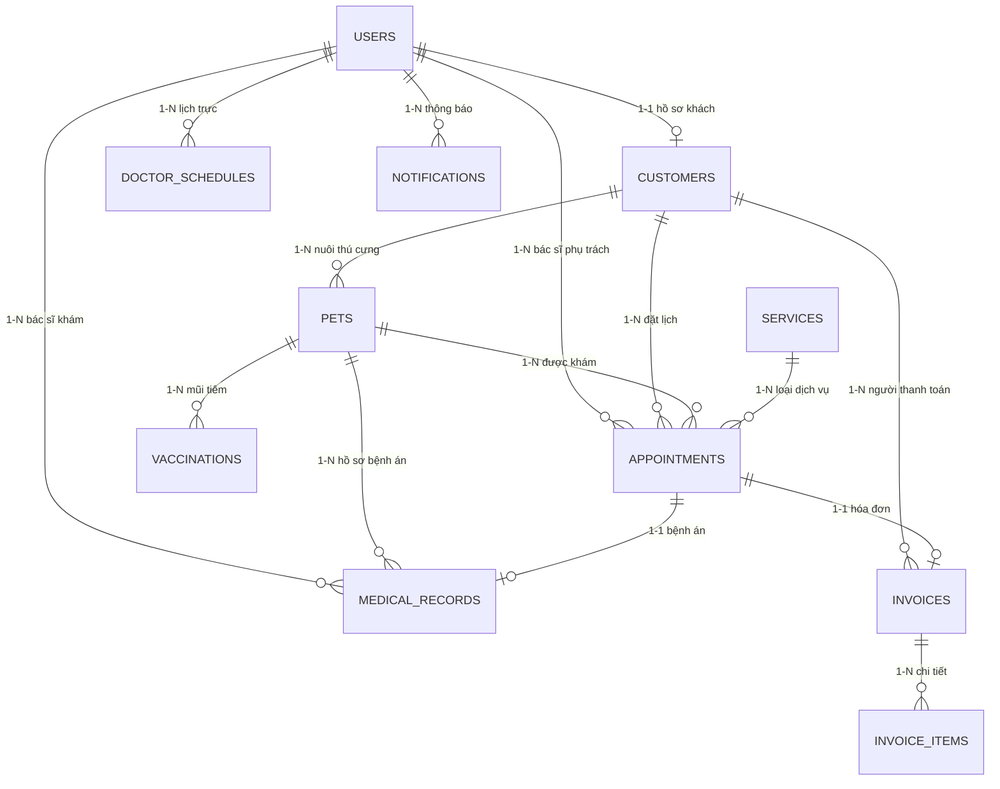

# TÀI LIỆU THIẾT KẾ CƠ SỞ DỮ LIỆU (DATABASE SCHEMA)
## Hệ thống Quản lý Trung tâm Thú y — **PetCare**

> **Tài liệu:** Database Specification & Data Dictionary  
> **Hệ quản trị CSDL:** SQLite 3 (Tương thích ANSI SQL)  
> **Phiên bản:** 1.0 | **Ngày lập:** 16/11/2026

---

## 1. Sơ đồ Thực thể - Liên kết (ERD)

---

## 2. Danh sách 12 bảng trong CSDL

1. `users` — Người dùng hệ thống (Admin, Doctor, Cashier, Customer)
2. `customers` — Thông tin bổ sung khách hàng
3. `services` — Danh mục dịch vụ và bảng giá
4. `pets` — Hồ sơ thú cưng
5. `vaccinations` — Sổ theo dõi tiêm phòng
6. `doctor_schedules` — Lịch trực bác sĩ
7. `appointments` — Cuộc hẹn khám bệnh
8. `medical_records` — Bệnh án chi tiết
9. `invoices` — Hóa đơn thanh toán
10. `invoice_items` — Chi tiết dòng phụ phí
11. `notifications` — Thông báo nội bộ
12. `messages` — Tin nhắn liên hệ từ khách
