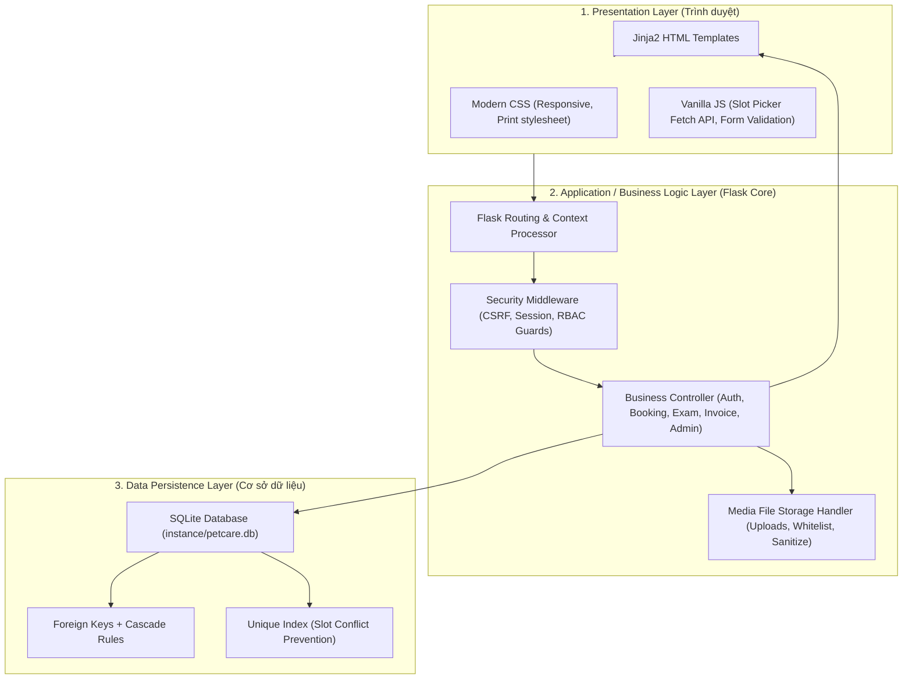
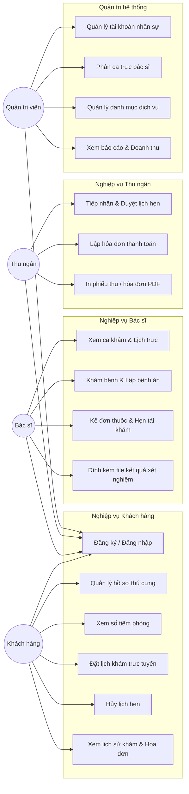
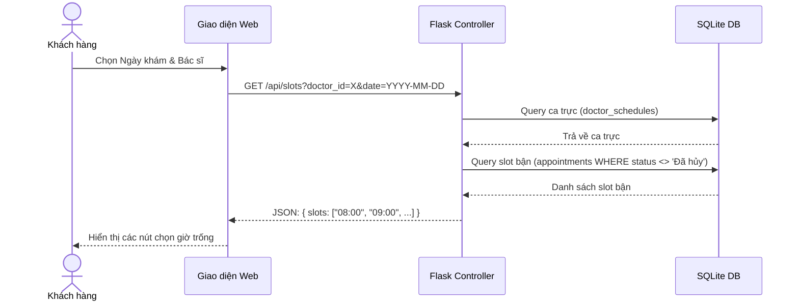

# TÀI LIỆU PHÂN TÍCH VÀ THIẾT KẾ HỆ THỐNG (SAD)
## Hệ thống Quản lý Trung tâm Thú y — **PetCare**

> **Tài liệu:** System Architecture & Design Document (SAD)  
> **Phiên bản:** 1.0 | **Ngày lập:** 16/11/2026 | **Đối tượng:** Đồ án môn học / Báo cáo kỹ thuật  
> **Dự án:** PetCare Web Application (Flask + SQLite)

---

## 1. Giới thiệu & Mục tiêu thiết kế

### 1.1 Mục đích tài liệu
Tài liệu này đặc tả chi tiết kiến trúc phần mềm, các mô hình phân tích (Use Case, Activity, Sequence, State), thiết kế thành phần logic và kiến trúc an toàn dữ liệu cho hệ thống **PetCare**. Tài liệu đóng vai trò kim chỉ nam kỹ thuật cho nhóm phát triển và tài liệu thẩm định cho hội đồng chấm đồ án.

### 1.2 Mục tiêu thiết kế (Architectural Goals)
- **Đơn giản & Dễ vận hành:** Sử dụng kiến trúc Client-Server với Flask (Python) và SQLite, không cần cấu hình server phức tạp, tự migrate dữ liệu khi khởi động.
- **Tính toàn vẹn & Tin cậy dữ liệu:** Kiểm soát xung đột lịch hẹn bằng SQLite Partial Unique Index; đảm bảo khóa ngoại và ràng buộc cascade.
- **Bảo mật nhiều lớp:** Xác thực Cookie Session an toàn, kiểm soát quyền theo vai trò (RBAC), phòng chống CSRF bắt buộc trên toàn bộ form POST, mã hóa mật khẩu PBKDF2, kiểm tra whitelist và kích thước file upload (5 MB).

---

## 2. Kiến trúc hệ thống tổng thể

---

## 3. Phân tích Use Case chi tiết

---

## 4. Biểu đồ tuần tự (Sequence Diagram)

### Đặt lịch khám và Kiểm tra Slot trống

---

## 5. Ma trận phân quyền (RBAC Matrix)

| Chức năng / Endpoint | Khách vãng lai | CUSTOMER | DOCTOR | CASHIER | ADMIN |
|---|:---:|:---:|:---:|:---:|:---:|
| Trang chủ, Dịch vụ, Bác sĩ | ✅ | ✅ | ✅ | ✅ | ✅ |
| Đặt lịch trực tuyến | ✅ | ✅ | ❌ | ❌ | ✅ |
| Quản lý thú cưng, tiêm phòng | ❌ | ✅ | ❌ | ❌ | ❌ |
| Lập bệnh án, kê đơn | ❌ | ❌ | ✅ | ❌ | ✅ |
| Duyệt lịch, Lập hóa đơn | ❌ | ❌ | ❌ | ✅ | ✅ |
| Quản lý nhân sự, dịch vụ, doanh thu | ❌ | ❌ | ❌ | ❌ | ✅ |
