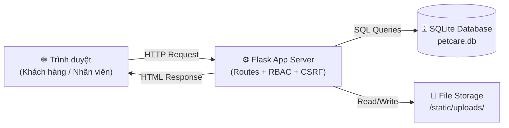
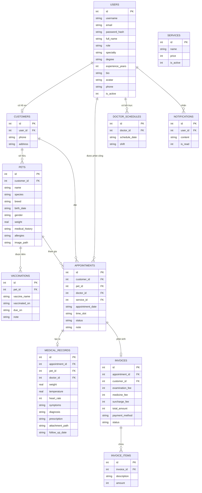
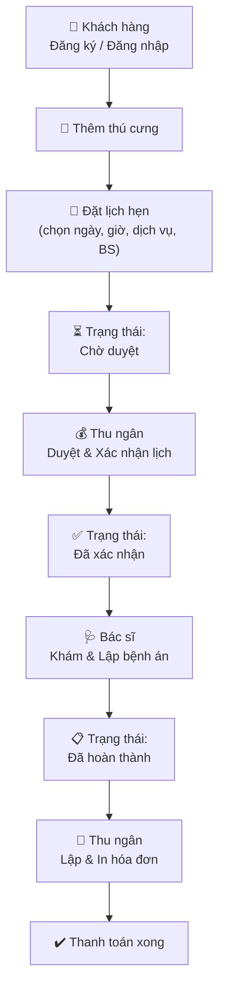

# ĐẶC TẢ YÊU CẦU PHẦN MỀM (SRS)
## Hệ thống Quản lý Trung tâm Thú y — **PetCare**

> **Phiên bản:** 1.0 &nbsp;|&nbsp; **Ngày:** 15/11/2026 &nbsp;|&nbsp; **Mức độ:** Sơ bộ (Preliminary)

---

## 1. Giới thiệu

### 1.1 Mục đích

Tài liệu này mô tả các yêu cầu chức năng và phi chức năng của hệ thống web **PetCare** — ứng dụng quản lý tổng thể cho trung tâm thú y, bao gồm quản lý khách hàng, thú cưng, lịch khám, bệnh án và thanh toán. Tài liệu được lập nhằm mục đích nộp đồ án môn học.

### 1.2 Phạm vi dự án

**PetCare** là ứng dụng web đơn trang (single-server web app) xây dựng bằng **Flask (Python) + SQLite**, triển khai nội bộ. Hệ thống phục vụ 4 nhóm người dùng: Khách hàng, Bác sĩ, Thu ngân và Quản trị viên.

### 1.3 Các từ viết tắt

| Ký hiệu | Nghĩa |
|---------|-------|
| SRS | Software Requirements Specification |
| WBS | Work Breakdown Structure |
| RBAC | Role-Based Access Control |
| CSRF | Cross-Site Request Forgery |
| UC | Use Case |
| FR | Functional Requirement |
| NFR | Non-Functional Requirement |

### 1.4 Tài liệu tham chiếu

- `README.md` — hướng dẫn cài đặt và vận hành
- `docs/system-analysis.md` — phân tích hệ thống và ERD
- `docs/demo-and-test-cases.md` — kịch bản demo và test case

---

## 2. Mô tả tổng quan hệ thống

### 2.1 Bối cảnh

Các trung tâm thú y quy mô vừa và nhỏ hiện quản lý lịch hẹn, hồ sơ bệnh án và thanh toán thủ công hoặc qua bảng tính, dẫn đến sai sót và khó tra cứu. **PetCare** số hóa toàn bộ quy trình này trên nền tảng web.

### 2.2 Kiến trúc tổng thể

### 2.3 Các vai trò người dùng

| Vai trò | Mô tả |
|---------|-------|
| **CUSTOMER** (Khách hàng) | Đăng ký tài khoản, quản lý thú cưng, đặt lịch khám, xem hóa đơn |
| **DOCTOR** (Bác sĩ) | Xem ca trực, thực hiện khám, lập bệnh án, kê đơn thuốc |
| **CASHIER** (Thu ngân) | Duyệt lịch hẹn, lập hóa đơn, in phiếu thanh toán |
| **ADMIN** (Quản trị viên) | Quản lý toàn hệ thống: nhân sự, dịch vụ, thống kê |

---

## 3. Yêu cầu chức năng (Functional Requirements)

### 3.1 Mô-đun Xác thực & Phân quyền

| Mã | Tên yêu cầu | Mô tả |
|----|-------------|-------|
| FR-01 | Đăng ký tài khoản | Khách hàng mới tự đăng ký với username, email, mật khẩu, số điện thoại |
| FR-02 | Đăng nhập | Tất cả vai trò đăng nhập bằng username + mật khẩu; session được duy trì bằng cookie |
| FR-03 | Đăng xuất | Người dùng có thể đăng xuất và xóa session |
| FR-04 | Phân quyền RBAC | Mỗi route chỉ cho phép vai trò được ủy quyền; trả về HTTP 403 nếu vi phạm |
| FR-05 | Bảo vệ CSRF | Mọi form POST phải kèm CSRF token hợp lệ trong session |
| FR-06 | Quên mật khẩu | Chức năng đặt lại mật khẩu (UI có, chức năng email tùy triển khai) |
| FR-07 | Hồ sơ cá nhân | Người dùng xem và chỉnh sửa thông tin cá nhân, ảnh đại diện |

### 3.2 Mô-đun Quản lý Thú cưng (CUSTOMER)

| Mã | Tên yêu cầu | Mô tả |
|----|-------------|-------|
| FR-10 | Thêm thú cưng | Khách hàng thêm thú cưng: tên, loài, giống, ngày sinh, giới tính, cân nặng, ảnh |
| FR-11 | Xem danh sách thú cưng | Hiển thị tất cả thú cưng của khách hàng đang đăng nhập |
| FR-12 | Chỉnh sửa thú cưng | Cập nhật thông tin, tiền sử bệnh, dị ứng |
| FR-13 | Xóa thú cưng | Khách hàng xóa thú cưng khỏi hồ sơ (cascade xóa lịch sử liên quan) |
| FR-14 | Upload ảnh thú cưng | Chấp nhận PNG/JPG/JPEG/WEBP, tối đa 5 MB |
| FR-15 | Quản lý tiêm phòng | Khách hàng xem và bác sĩ ghi nhận lịch sử tiêm vắc-xin |

### 3.3 Mô-đun Đặt lịch khám (CUSTOMER / ADMIN)

| Mã | Tên yêu cầu | Mô tả |
|----|-------------|-------|
| FR-20 | Đặt lịch hẹn | Khách hàng chọn ngày, khung giờ, dịch vụ, bác sĩ và thú cưng |
| FR-21 | Chọn khung giờ có sẵn | Hệ thống chỉ hiển thị slot bác sĩ còn trống, không bị trùng lịch |
| FR-22 | Hủy lịch hẹn | Khách hàng hủy lịch; trạng thái chuyển thành "Đã hủy" |
| FR-23 | Xem lịch sử đặt lịch | Khách hàng xem toàn bộ lịch hẹn kèm trạng thái |
| FR-24 | Thông báo đặt lịch | Hệ thống tạo thông báo nội bộ cho bác sĩ được phân công |
| FR-25 | Admin tạo lịch hẹn | Quản trị viên có thể tạo/sửa lịch hẹn thay khách hàng |

### 3.4 Mô-đun Quản lý Ca khám & Lịch trực (DOCTOR / ADMIN)

| Mã | Tên yêu cầu | Mô tả |
|----|-------------|-------|
| FR-30 | Xem ca khám trong ngày | Bác sĩ xem danh sách lịch hẹn được phân công theo ngày |
| FR-31 | Cập nhật trạng thái lịch hẹn | Bác sĩ chuyển trạng thái: Đã xác nhận → Đang khám → Đã hoàn thành |
| FR-32 | Lập bệnh án | Bác sĩ nhập triệu chứng, chuẩn đoán, đơn thuốc, nhiệt độ, cân nặng, nhịp tim |
| FR-33 | Đặt lịch tái khám | Bác sĩ ghi ngày tái khám trong bệnh án |
| FR-34 | Upload file bệnh án | Bác sĩ đính kèm ảnh X-quang hoặc kết quả xét nghiệm |
| FR-35 | Quản lý lịch trực | Admin phân ca (Sáng/Chiều/Cả ngày) cho từng bác sĩ theo ngày |
| FR-36 | Xem lịch sử bệnh án thú cưng | Bác sĩ xem toàn bộ lịch sử khám của một thú cưng |

### 3.5 Mô-đun Thanh toán & Hóa đơn (CASHIER)

| Mã | Tên yêu cầu | Mô tả |
|----|-------------|-------|
| FR-40 | Duyệt lịch hẹn chờ | Thu ngân xem và xác nhận lịch hẹn trạng thái "Chờ duyệt" |
| FR-41 | Lập hóa đơn | Thu ngân tạo hóa đơn: phí khám, phí thuốc, phụ thu, tổng tiền |
| FR-42 | Thêm hạng mục hóa đơn | Thêm nhiều dòng mục chi tiết vào hóa đơn (invoice_items) |
| FR-43 | Chọn phương thức thanh toán | Hỗ trợ: Tiền mặt, Chuyển khoản |
| FR-44 | In hóa đơn | In hoặc lưu PDF hóa đơn qua hộp thoại in trình duyệt |
| FR-45 | Xem lịch sử hóa đơn | Thu ngân xem danh sách và chi tiết hóa đơn đã lập |

### 3.6 Mô-đun Quản trị Hệ thống (ADMIN)

| Mã | Tên yêu cầu | Mô tả |
|----|-------------|-------|
| FR-50 | Quản lý người dùng | Thêm, sửa, khoá/mở tài khoản bác sĩ, thu ngân, khách hàng |
| FR-51 | Quản lý dịch vụ | Thêm, sửa, bật/tắt dịch vụ và giá |
| FR-52 | Dashboard thống kê | Xem tổng lịch hẹn, doanh thu, số thú cưng, bác sĩ hoạt động |
| FR-53 | Quản lý tin nhắn liên hệ | Xem và đánh dấu đã đọc tin nhắn từ form liên hệ trên trang chủ |
| FR-54 | Quản lý thông báo | Hệ thống tạo và phân phối thông báo nội bộ cho các vai trò |
| FR-55 | Hồ sơ bác sĩ công khai | Hiển thị thông tin bác sĩ (chuyên khoa, bằng cấp, kinh nghiệm) trên trang web |

### 3.7 Trang thông tin công khai (Khách vãng lai)

| Mã | Tên yêu cầu | Mô tả |
|----|-------------|-------|
| FR-60 | Trang chủ | Giới thiệu trung tâm, dịch vụ nổi bật, đội ngũ bác sĩ |
| FR-61 | Trang dịch vụ | Danh sách dịch vụ và bảng giá công khai |
| FR-62 | Trang bác sĩ | Danh sách và trang chi tiết từng bác sĩ |
| FR-63 | Trang liên hệ | Form gửi tin nhắn, địa chỉ, bản đồ nhúng |
| FR-64 | Trang chính sách | Điều khoản sử dụng và chính sách bảo mật |

---

## 4. Yêu cầu phi chức năng (Non-Functional Requirements)

| Mã | Hạng mục | Yêu cầu |
|----|----------|---------|
| NFR-01 | **Bảo mật** | Mật khẩu băm bằng Werkzeug (PBKDF2-SHA256); CSRF token trên mọi form POST |
| NFR-02 | **Phân quyền** | RBAC nghiêm ngặt: mỗi endpoint kiểm tra role trước khi xử lý |
| NFR-03 | **Upload file** | Chỉ chấp nhận PNG/JPG/JPEG/WEBP; giới hạn 5 MB mỗi file; tên file được sanitize |
| NFR-04 | **Hiệu năng** | Phản hồi trang < 2 giây với dữ liệu thực tế quy mô nhỏ (< 1.000 bệnh án) |
| NFR-05 | **Khả năng bảo trì** | Schema tự migrate (thêm cột/bảng) khi cập nhật, không xóa dữ liệu cũ |
| NFR-06 | **Backup** | Tự backup DB vào `instance/backups/` trước mỗi lần nâng cấp schema |
| NFR-07 | **Tương thích** | Chạy trên Windows với Python 3.10+ và Flask 3.x |
| NFR-08 | **Khả dụng** | Ứng dụng hoạt động cục bộ hoặc LAN; không yêu cầu kết nối Internet |
| NFR-09 | **Kiểm thử** | Có bộ unit test bằng pytest, chạy độc lập với DB production |
| NFR-10 | **Giao diện** | Responsive, hỗ trợ in hóa đơn qua hộp thoại in trình duyệt |

---

## 5. Mô hình dữ liệu (ERD tóm tắt)

---

## 6. Luồng nghiệp vụ chính

---

## 7. Giả định và ràng buộc

- Hệ thống chạy đơn máy chủ (single-server), không triển khai phân tán.
- Cơ sở dữ liệu SQLite phù hợp cho quy mô vừa và nhỏ; có thể nâng cấp lên PostgreSQL về sau.
- Không tích hợp cổng thanh toán điện tử trong phiên bản hiện tại (v1.0).
- Không tích hợp email tự động trong phiên bản hiện tại.
- Người dùng cần trình duyệt hiện đại (Chrome, Firefox, Edge) để sử dụng đầy đủ chức năng in.

---

## 8. Yêu cầu kiểm thử

| Loại test | Mô tả |
|-----------|-------|
| Unit Test | Kiểm tra từng route với `pytest` và SQLite in-memory |
| Integration Test | Kiểm tra luồng đặt lịch → khám → thanh toán end-to-end |
| Security Test | Kiểm tra CSRF protection, phân quyền, upload file |
| Usability Test | Kiểm tra giao diện đặt lịch và in hóa đơn trên trình duyệt |
