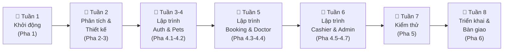

# CẤU TRÚC PHÂN CHIA CÔNG VIỆC (WBS)
## Dự án: Hệ thống Quản lý Trung tâm Thú y — **PetCare**

> **Phiên bản:** 1.0 &nbsp;|&nbsp; **Ngày:** 15/11/2026 &nbsp;|&nbsp; **Loại dự án:** Đồ án môn học

---

## Sơ đồ WBS tổng quan

```mermaid
flowchart TD
    ROOT["🐾 PetCare Web App<br/>(1.0)"]

    ROOT --> P1["1. Khởi động dự án"]
    ROOT --> P2["2. Phân tích & Yêu cầu"]
    ROOT --> P3["3. Thiết kế hệ thống"]
    ROOT --> P4["4. Lập trình & Tích hợp"]
    ROOT --> P5["5. Kiểm thử"]
    ROOT --> P6["6. Triển khai & Bàn giao"]

    P1 --> P1a["1.1 Xác định mục tiêu\n& phạm vi"]
    P1 --> P1b["1.2 Lập kế hoạch\n& phân công"]

    P2 --> P2a["2.1 Thu thập\nyêu cầu"]
    P2 --> P2b["2.2 Viết SRS\nsơ bộ"]
    P2 --> P2c["2.3 Xây dựng\nUse Case"]

    P3 --> P3a["3.1 Thiết kế\nCSDL (ERD)"]
    P3 --> P3b["3.2 Thiết kế\nkiến trúc hệ thống"]
    P3 --> P3c["3.3 Wireframe\ngiao diện"]

    P4 --> P4a["4.1 Xác thực\n& Phân quyền"]
    P4 --> P4b["4.2 Quản lý\nThú cưng"]
    P4 --> P4c["4.3 Đặt lịch\nkhám"]
    P4 --> P4d["4.4 Bệnh án\n& Bác sĩ"]
    P4 --> P4e["4.5 Hóa đơn\n& Thu ngân"]
    P4 --> P4f["4.6 Admin\nDashboard"]
    P4 --> P4g["4.7 Trang\ncông khai"]

    P5 --> P5a["5.1 Unit Test\n(pytest)"]
    P5 --> P5b["5.2 Integration\nTest"]
    P5 --> P5c["5.3 UAT &\nDemo"]

    P6 --> P6a["6.1 Seed dữ\nliệu demo"]
    P6 --> P6b["6.2 Viết tài\nliệu hướng dẫn"]
    P6 --> P6c["6.3 Báo cáo\n& Nộp đồ án"]
```

---

## Bảng WBS chi tiết

### Pha 1 — Khởi động dự án

| Mã WBS | Hạng mục công việc | Mô tả chi tiết | Đầu ra |
|--------|-------------------|----------------|--------|
| 1.0 | **Khởi động dự án** | | |
| 1.1 | Xác định mục tiêu & phạm vi | Họp nhóm, xác định rõ bài toán cần giải quyết, đối tượng sử dụng, phạm vi v1.0 | Biên bản họp, Statement of Scope |
| 1.2 | Lập kế hoạch dự án | Phân chia công việc theo WBS, ước lượng thời gian, phân công thành viên | File WBS, lịch biểu (Gantt chart) |
| 1.3 | Thiết lập môi trường dev | Cài Python, Flask, SQLite, VS Code; tạo repo Git, cấu trúc thư mục ban đầu | Repo Git sẵn sàng, `requirements.txt`, `.env.example` |

### Pha 2 — Phân tích & Yêu cầu

| Mã WBS | Hạng mục công việc | Mô tả chi tiết | Đầu ra |
|--------|-------------------|----------------|--------|
| 2.0 | **Phân tích & Yêu cầu** | | |
| 2.1 | Thu thập yêu cầu | Phỏng vấn (giả định) các vai trò: khách hàng, bác sĩ, thu ngân, admin; liệt kê nghiệp vụ | Danh sách yêu cầu thô |
| 2.2 | Viết SRS sơ bộ | Phân tích và viết FR, NFR, ràng buộc hệ thống theo chuẩn IEEE 830 | Tài liệu SRS (file này) |
| 2.3 | Xây dựng Use Case | Vẽ sơ đồ use case cho 4 vai trò; mô tả luồng chính và luồng thay thế | Sơ đồ UC + mô tả UC |
| 2.4 | Phân tích nghiệp vụ | Vẽ luồng quy trình: đặt lịch → khám → thanh toán | Activity Diagram / Flowchart |

### Pha 3 — Thiết kế hệ thống

| Mã WBS | Hạng mục công việc | Mô tả chi tiết | Đầu ra |
|--------|-------------------|----------------|--------|
| 3.0 | **Thiết kế hệ thống** | | |
| 3.1 | Thiết kế CSDL | Vẽ ERD đầy đủ 10 bảng; định nghĩa kiểu dữ liệu, khóa, ràng buộc | ERD + SQL schema |
| 3.2 | Thiết kế kiến trúc | Xác định kiến trúc Flask (MVC-lite); thiết kế routing, middleware RBAC & CSRF | Sơ đồ kiến trúc |
| 3.3 | Thiết kế giao diện (Wireframe) | Phác thảo màn hình: trang chủ, dashboard từng vai trò, form đặt lịch, hóa đơn | Wireframe / mockup |
| 3.4 | Thiết kế bảo mật | Quy định hashing, CSRF protection, validate đầu vào, upload file an toàn | Tài liệu thiết kế bảo mật |

### Pha 4 — Lập trình & Tích hợp

| Mã WBS | Hạng mục công việc | Mô tả chi tiết | Đầu ra |
|--------|-------------------|----------------|--------|
| 4.0 | **Lập trình & Tích hợp** | | |
| **4.1** | **Mô-đun Xác thực & Phân quyền** | | |
| 4.1.1 | Đăng ký tài khoản | Form đăng ký, validate, hash password, insert DB | Route `/register` hoạt động |
| 4.1.2 | Đăng nhập / Đăng xuất | Xác thực session, flash message lỗi/thành công | Route `/login`, `/logout` |
| 4.1.3 | Middleware RBAC | Decorator `role_required(*roles)` áp dụng cho tất cả route nhạy cảm | Phân quyền hoạt động |
| 4.1.4 | CSRF Protection | Inject token vào session, validate trên mọi POST | Bảo vệ CSRF hoạt động |
| 4.1.5 | Hồ sơ cá nhân | Xem và chỉnh sửa thông tin, upload avatar | Route `/profile` |
| **4.2** | **Mô-đun Quản lý Thú cưng** | | |
| 4.2.1 | CRUD thú cưng | Thêm/sửa/xóa thú cưng; upload ảnh | Route `/pets` |
| 4.2.2 | Lịch sử tiêm phòng | Thêm/xem bản ghi vaccination | Route `/vaccinations` |
| **4.3** | **Mô-đun Đặt lịch khám** | | |
| 4.3.1 | Form đặt lịch | Chọn ngày, bác sĩ, dịch vụ, thú cưng | Route `/booking` |
| 4.3.2 | Kiểm tra slot trống | Query DB loại trừ slot đã đặt; unique constraint DB | Logic kiểm tra slot |
| 4.3.3 | Hủy lịch hẹn | Khách hàng hủy; cập nhật trạng thái + thông báo | Route `/appointments/cancel` |
| 4.3.4 | Thông báo nội bộ | Tạo notification cho bác sĩ khi có lịch mới | Bảng notifications |
| **4.4** | **Mô-đun Bác sĩ & Bệnh án** | | |
| 4.4.1 | Dashboard bác sĩ | Danh sách ca khám trong ngày, bộ lọc ngày | Route `/doctor/dashboard` |
| 4.4.2 | Lập bệnh án | Form nhập triệu chứng, chẩn đoán, đơn thuốc, chỉ số sinh hiệu | Route `/exam/<id>` |
| 4.4.3 | Upload file bệnh án | Đính kèm ảnh X-quang/kết quả xét nghiệm | Upload file medical |
| 4.4.4 | Lịch trực bác sĩ | Admin phân ca; bác sĩ xem lịch | Route `/schedules` |
| 4.4.5 | Lịch sử bệnh án thú cưng | Bác sĩ xem toàn bộ hồ sơ một thú cưng | Route `/doctor/pet-history/<id>` |
| **4.5** | **Mô-đun Thu ngân & Hóa đơn** | | |
| 4.5.1 | Dashboard thu ngân | Danh sách lịch hẹn chờ duyệt, lọc theo ngày | Route `/cashier/dashboard` |
| 4.5.2 | Duyệt lịch hẹn | Xác nhận lịch hẹn chờ → Đã xác nhận | Route duyệt lịch |
| 4.5.3 | Lập hóa đơn | Form tạo invoice: phí khám, thuốc, phụ thu, invoice_items | Route `/invoice/create` |
| 4.5.4 | In hóa đơn | Template in PDF qua print dialog trình duyệt | Route `/invoice/<id>/print` |
| **4.6** | **Mô-đun Admin Dashboard** | | |
| 4.6.1 | Dashboard thống kê | Tổng lịch hẹn, doanh thu, số thú cưng | Route `/admin/dashboard` |
| 4.6.2 | Quản lý người dùng | CRUD tài khoản bác sĩ/cashier/customer; khoá tài khoản | Route `/admin/staff` |
| 4.6.3 | Quản lý dịch vụ | Thêm/sửa/bật-tắt dịch vụ và giá | Route `/admin/services` |
| 4.6.4 | Quản lý tin nhắn liên hệ | Xem và đánh dấu đọc tin nhắn từ form contact | Route `/admin/messages` |
| **4.7** | **Trang thông tin công khai** | | |
| 4.7.1 | Trang chủ | Hero, dịch vụ nổi bật, đội ngũ bác sĩ, CTA | Route `/` |
| 4.7.2 | Trang Dịch vụ, Bác sĩ, Liên hệ | Các trang tĩnh + form liên hệ | Routes `/services`, `/doctors`, `/contact` |

### Pha 5 — Kiểm thử

| Mã WBS | Hạng mục công việc | Mô tả chi tiết | Đầu ra |
|--------|-------------------|----------------|--------|
| 5.0 | **Kiểm thử** | | |
| 5.1 | Viết Unit Test | Viết test cho từng route bằng `pytest` với SQLite in-memory | File `tests/test_app.py` |
| 5.2 | Integration Test | Kiểm tra luồng end-to-end: đặt lịch → khám → hóa đơn | File `tests/test_doctor_portal.py` |
| 5.3 | Test bảo mật | Kiểm tra CSRF, phân quyền 403, upload file ngoài định dạng | Báo cáo security test |
| 5.4 | UAT & Demo | Chạy với dữ liệu seed, demo từng vai trò, ghi nhận lỗi | Biên bản UAT |
| 5.5 | Sửa lỗi & Retest | Fix bug phát sinh trong UAT, chạy lại bộ test | Bug list + status |

### Pha 6 — Triển khai & Bàn giao

| Mã WBS | Hạng mục công việc | Mô tả chi tiết | Đầu ra |
|--------|-------------------|----------------|--------|
| 6.0 | **Triển khai & Bàn giao** | | |
| 6.1 | Chuẩn bị dữ liệu demo | Chạy `seed_demo.py`, tạo tài khoản demo các vai trò | DB demo sẵn sàng |
| 6.2 | Viết tài liệu hướng dẫn | Hướng dẫn cài đặt, vận hành, hướng dẫn sử dụng từng vai trò | `README.md`, user guide |
| 6.3 | Viết báo cáo đồ án | Báo cáo kỹ thuật theo mẫu: giới thiệu, thiết kế, kết quả, hạn chế | File báo cáo (Word/PDF) |
| 6.4 | Nộp đồ án | Nén project, nộp lên hệ thống; chuẩn bị slide thuyết trình | ZIP project + slide |
| 6.5 | Thuyết trình & Bảo vệ | Demo live, trả lời câu hỏi hội đồng | Buổi bảo vệ |

---

## Tiến độ gợi ý (Timeline)

> Giả sử dự án kéo dài **8 tuần** từ khi bắt đầu.

---

## Tóm tắt khối lượng công việc

| Pha | Tên | Số task |
|-----|-----|---------|
| 1 | Khởi động dự án | 3 |
| 2 | Phân tích & Yêu cầu | 4 |
| 3 | Thiết kế hệ thống | 4 |
| 4 | Lập trình & Tích hợp | 23 |
| 5 | Kiểm thử | 5 |
| 6 | Triển khai & Bàn giao | 5 |
| **Tổng** | | **44 task** |
