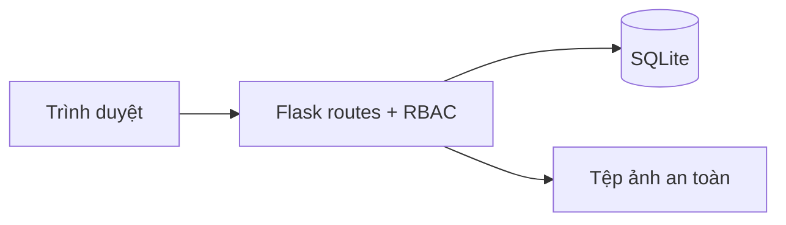
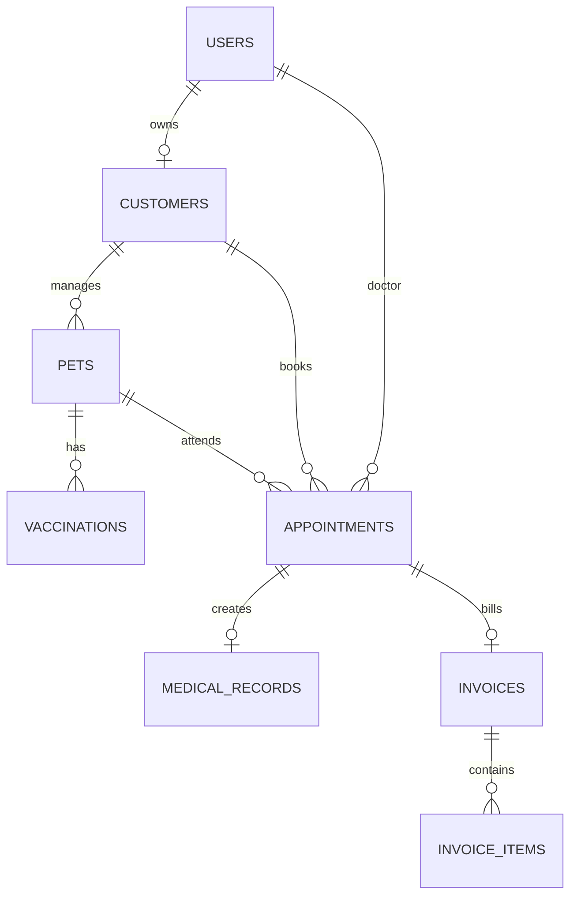

# PetCare — Phân tích hệ thống

## Vai trò và use case

| Vai trò | Chức năng chính |
|---|---|
| Khách hàng | Đăng ký, quản lý thú cưng, tiêm phòng, đặt/hủy lịch, xem hóa đơn |
| Thu ngân | Duyệt lịch, lập và in hóa đơn |
| Bác sĩ | Xem ca khám, lập bệnh án và hẹn tái khám |
| Quản trị viên | Quản lý nhân sự, dịch vụ và theo dõi thống kê |

## Kiến trúc

## ERD rút gọn

